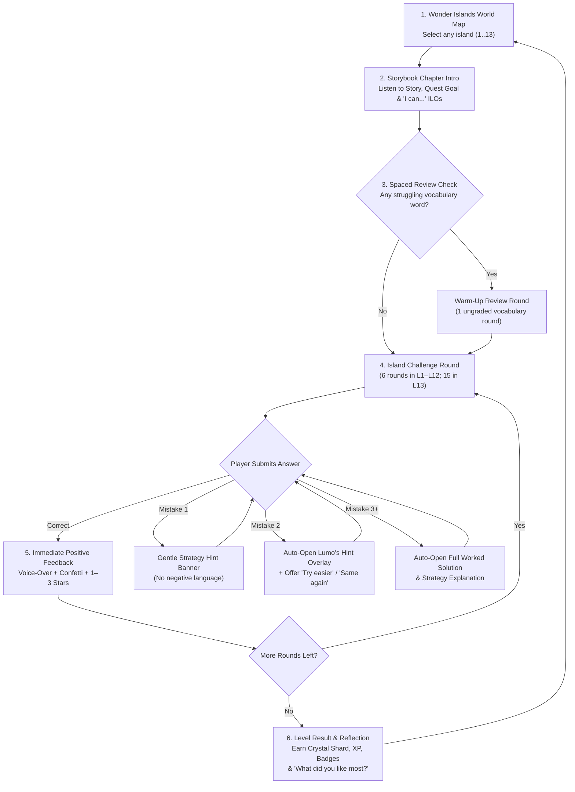

# Game Design Document (GDD) — Lumo and the Crystal of Knowledge

---

## 1. Executive Summary & Design Pillars

**Lumo and the Crystal of Knowledge** is a 2D storybook educational game for children aged **5–12**. It combines curriculum-aligned math, English literacy, science, spatial logic, art, music, and social-emotional learning into a single cohesive adventure across **13 Wonder Islands**.

### Core Design Pillars
1. **Intrinsic Fantasy Integration:** Every puzzle is embedded in the kingdom's world—counting fruit harvests for King Arqam, brewing star potions with Princess Lexi, rebuilding broken bridges, and echoing crystal melodies.
2. **Low-Anxiety, High-Agency Play:** By default, the game runs in **untimed Free Sail mode**. Mistakes never trigger "Game Over" or punitive buzzers; instead, Lumo offers strategy-specific retry encouragement, a 2-mistake hint, a 3-mistake full worked explanation, and an optional *"Try an easier one"* learner-agency choice.
3. **Multi-Modal Accessibility:** Every prompt and feedback line is paired with offline voice-over narration (`663` clips), color-blind-safe shape/label dual coding, and a single-click **Calm Mode** that removes timers and animations for sensory-sensitive learners.

---

## 2. Core Gameplay Loop

---

## 3. Complete Specification of the 12 Puzzle Modules

All 12 interactive puzzle modules inherit from [`ModuleBase`](file:///d:/Unity/lumooo/Assets/Scripts/Modules/ModuleBase.cs) and render inside `GameplayScreen`'s `ActivityArea` (`y = 0.25..0.85`) and `AnswerArea` (`y = 0.03..0.24`).

| # | Module ID | Class File | Primary Skills | Interaction Mechanics |
|---|---|---|---|---|
| 1 | `math-choice` | [`MathChoiceModule.cs`](file:///d:/Unity/lumooo/Assets/Scripts/Modules/MathChoiceModule.cs) | `addition`, `subtraction`, `twoStep`, `counting` | Renders visual object groups (`+`, `-`, or single counting tray), an interactive `0..20` number line (L7), or a two-step equation card (L10), with 3 numeric answer buttons in `AnswerArea`. On correct addition, the two groups physically slide together. |
| 2 | `word-picture` | [`WordPictureModule.cs`](file:///d:/Unity/lumooo/Assets/Scripts/Modules/WordPictureModule.cs) | `vocabulary` | Displays a target word banner with a `[Hear Word]` button above 3 illustrated object cards (supporting color tinting and `BIG`/`SMALL` scale modifiers in L8). |
| 3 | `matching` | [`MatchingModule.cs`](file:///d:/Unity/lumooo/Assets/Scripts/Modules/MatchingModule.cs) | `counting` | 3-column (Number, Picture, Word) or 2-column (Number, Word in L13 `F12`) board with 3 rows. Tapping one card per column that shares the same `pairId` locks the triple in green. |
| 4 | `spelling` | [`SpellingModule.cs`](file:///d:/Unity/lumooo/Assets/Scripts/Modules/SpellingModule.cs) | `spelling` | Shows the target object picture + `[Hear Word]` button, dashed letter drop slots (`ui_slot`), and scrambled letter chips (`DragChip`) that support both drag-and-drop and tap-to-place. |
| 5 | `potion` | [`PotionModule.cs`](file:///d:/Unity/lumooo/Assets/Scripts/Modules/PotionModule.cs) | `addition`, `subtraction` | Interactive cauldron (`obj_cauldron`) with colored star ingredients (`red`, `blue`, `green`, `yellow`). Players tap stars to add/remove them until the recipe counts match, then tap the total number button. |
| 6 | `directions` | [`DirectionsModule.cs`](file:///d:/Unity/lumooo/Assets/Scripts/Modules/DirectionsModule.cs) | `directions`, `counting` | **Grid Mode:** `5×5` tile map + 4-way D-Pad (`Up`, `Down`, `Left`, `Right`) to guide the Hero token to the Treasure Chest. **Key Mode (`L9R3`):** Tap keys (`obj_key`) to collect the target count, then answer the subtraction prompt. |
| 7 | `sentence` | [`SentenceModule.cs`](file:///d:/Unity/lumooo/Assets/Scripts/Modules/SentenceModule.cs) | `sentence` | Displays `[Hear Sentence]` button, ordered word slots, and scrambled word tiles. Placing all words in left-to-right syntactic order completes the sentence. |
| 8 | `sorting` | [`SortingModule.cs`](file:///d:/Unity/lumooo/Assets/Scripts/Modules/SortingModule.cs) | `addition`, `counting`, `subtraction` | Two-phase workshop activity: first drag/tap mixed items (`obj_star`, `obj_gem`) into the **Red Box** and **Blue Box**; once sorted, answer buttons appear to report the group count. |
| 9 | `choice-card` | [`ChoiceCardModule.cs`](file:///d:/Unity/lumooo/Assets/Scripts/Modules/ChoiceCardModule.cs) | `science`, `kindness`, `vocabulary`, `addition`, `counting`, `twoStep`, `directions` | Rich reading/discovery card with an optional illustration or clue banner (`media.clue`) and 3–4 full-width or grid answer buttons. |
| 10 | `memory-match` | [`MemoryMatchModule.cs`](file:///d:/Unity/lumooo/Assets/Scripts/Modules/MemoryMatchModule.cs) | `memory`, `science` | Grid of face-down cards (`6` or `8` cards). Players flip two cards at a time; matching `pairId` pairs stay face-up in green, while mismatches flip back after `0.75s`. |
| 11 | `pixel-art` | [`PixelArtModule.cs`](file:///d:/Unity/lumooo/Assets/Scripts/Modules/PixelArtModule.cs) | `art` | Side-by-side **Target Grid** and interactive **Your Canvas** (`3×3` or `4×4`), plus color-named palette buttons (dual-coded with color swatch + English color name for accessibility). |
| 12 | `music-play` | [`MusicPlayModule.cs`](file:///d:/Unity/lumooo/Assets/Scripts/Modules/MusicPlayModule.cs) | `music` | Synthesizes pure sine-wave bell chimes (`C4..A4`) in real time (`AudioClip.Create`). Players tap `[Listen to Tune]` and echo the 3–5 note sequence on color-coded xylophone keys. |

---

## 4. Scoring, Star Rules, & Reward Economy

Implemented in [`GameRules.cs`](file:///d:/Unity/lumooo/Assets/Scripts/Core/GameRules.cs) and [`ScoreManager.cs`](file:///d:/Unity/lumooo/Assets/Scripts/Core/ScoreManager.cs).

### 4.1 Star Calculation Rules (`0–3 ★` per challenge)
- **Maximum Total Stars:** `261 ★` (`12 islands × 6 rounds × 3 ★ = 216 ★` + `Level 13 × 15 rounds × 3 ★ = 45 ★`).
- **Best-Score Retention:** Replaying a round only updates the saved star count if the new star score exceeds the previous best (`record.stars[roundIndex] = Max(old, new)`).

#### Untimed / Calm Mode (Default)
| Condition | Stars Awarded |
|---|---|
| Solved on **1st try** (`0` mistakes) with **no hints** used | **3 ★** |
| Solved with **≤ 1 mistake** (or `0` mistakes with a hint) | **2 ★** |
| Solved with **2 or more mistakes** | **1 ★** (never `0 ★` in untimed play) |

#### Optional Timed Mode (`30s` per round, LXD Accuracy-Gated)
To prevent fast random guessing from earning 3 stars, speed stars are **gated by first-try accuracy**:

| Elapsed Time | First-Try Correct (`firstTry == true`) | Non-First-Try (`firstTry == false`) |
|---|---|---|
| `0.0s – 10.0s` | **3 ★** | **1 ★** (capped) |
| `10.01s – 20.0s` | **2 ★** | **1 ★** (capped) |
| `20.01s – 30.0s` | **1 ★** | **1 ★** |
| `> 30.0s` (Timeout) | **0 ★** | **0 ★** |

### 4.2 Experience Points (XP), Shards, Badges, & Medals
- **XP per Challenge:** `+10 XP` (awarded on the **first completion** of a level so replays cannot farm infinite XP).
- **XP per Level Completion:** `+20 XP` base + `+10 XP` **No-Hint Perfect Bonus** (`outcome.PerfectNoHint`).
- **Crystal Shards (`12` total):** Completing each of Islands `1..12` awards `1` Crystal Shard (`ScoreManager.ShardsCollected()`).
- **Achievement Badges (`4` total):**
  - `Math Master` — Complete all Math-world islands (`L1, L4, L7, L10`).
  - `Word Explorer` — Complete all English-world islands (`L2, L5, L8, L11`).
  - `Puzzle Hero` — Complete all Mixed/Puzzle islands (`L3, L6, L9, L12`).
  - `Crystal Hero` — Complete the Grand Finale (`L13`).
- **Mastery Medals (`13` total, one per skill):** Permanently awarded whenever a skill reaches **Mastered** (`mastery == 3`).
