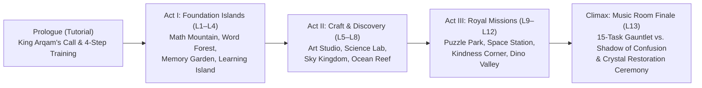
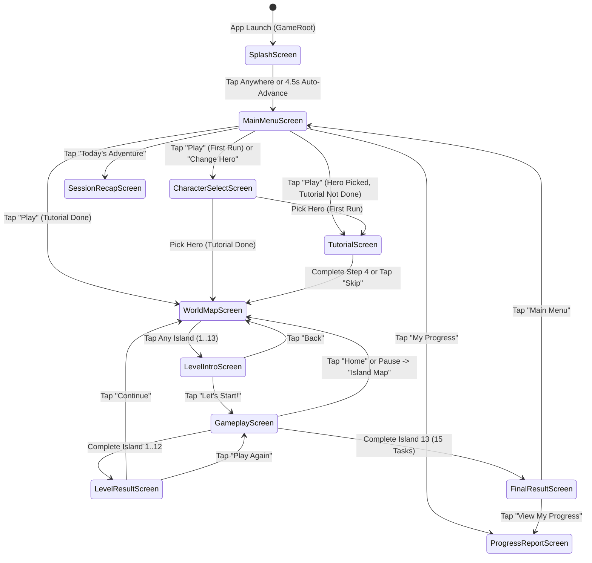

# Master Visual & Narrative Storyboard — Lumo and the Crystal of Knowledge

This document is the complete **Visual, Narrative, and Interactive Storyboard** for **Lumo and the Crystal of Knowledge**. It details the cast, the three-act story structure, the screen navigation flow, and every scene frame from the opening splash screen through all **13 Wonder Islands** to the Grand Finale ceremony.

---

## 1. Story Premise & Three-Act Narrative Structure

### Premise
High atop the royal citadel of the **Wonder Islands**, the **Crystal of Knowledge** kept numbers, words, music, and discovery in harmony. When the mischievous **Shadow of Confusion** shattered the Crystal into **12 glowing Crystal Shards** and scattered them across the archipelago, numbers tumbled out of order, letters flew off library pages, and bridges collapsed.

**King Arqam**, **Princess Lexi**, and **Lumo the Owl** summon a young adventurer (**Hero A** or **Hero B**) to sail from island to island, solve each island's challenges, recover all 12 shards, and reforge the Crystal in the **Music Room Finale**.



---

## 2. Cast of Characters & Visual Profiles

All character sprites reside in `Assets/Resources/Art/Characters/` at `600×600 px` with dark storybook ink outlines (`#281E18`).

| Character | Sprite File | Role in Story | Visual Appearance & Staging | Appearances |
|---|---|---|---|---|
| **Lumo the Owl** | `char_lumo.png` | **Primary Companion & Pedagogical Guide** | Friendly golden-brown owl with large expressive eyes. Appears inside a golden halo medallion or beside speech bubbles; delivers hints, encouragement, and session recaps. | Splash, Main Menu, Tutorial, All 13 Level Intros (Right Frame), Gameplay HUD, Hint Panel, Session Recap, Final Result |
| **King Arqam** | `char_king.png` | **Ruler of the Number & Logic Realms** | Warm, bearded monarch in a royal crown and red-gold robe. Hosts the math, logic, navigation, and workshop islands. | Tutorial Step 0 (Left), Level Intros L1, L3, L4, L7, L9, L10, L12 (Left Frame), Final Result (Left Frame) |
| **Princess Lexi** | `char_lexi.png` | **Host of Language, Science & Kindness** | Cheerful princess in a royal gown waving to the player. Guides reading, spelling, potion science, ocean vocabulary, and kindness islands. | Level Intros L2, L5, L6, L8, L11 (Left Frame), Final Result (Top-Right Frame) |
| **Hero A (Boy)** | `char_hero_a.png` | **Playable Adventurer (Avatar 1)** | Young explorer in adventurous tunic. Represents the player on the World Map boat/nodes, Treasure Map grid (L9/L13), and Certificate of Achievement. | Character Select (Left Card), World Map Avatar Token, Directions Module Grid |
| **Hero B (Girl)** | `char_hero_b.png` | **Playable Adventurer (Avatar 2)** | Young explorer in adventurous outfit. Represents the player on the World Map boat/nodes, Treasure Map grid (L9/L13), and Certificate of Achievement. | Character Select (Right Card), World Map Avatar Token, Directions Module Grid |
| **The Shadow of Confusion** | `char_shadow.png` | **Kid-Friendly Antagonist (Storm Mage)** | Dramatic purple-cloaked storm mage who scattered the 12 Crystal Shards. Never scary or punitive—challenges the hero to prove their knowledge in Level 13. | Tutorial Step 0 (Right), Level 13 Intro (Left Frame) |
| **Spark the Dragon** | `char_spark.png` | **Kingdom Mascot** | Friendly storybook dragon available for cutscene and promotional illustrations. | Storybook Art Catalog |

---

## 3. Master Screen Flow & Navigation Map



---

## 4. Frame-by-Frame Core UI Storyboard (Frames 01–08)

### Frame 01 — Splash Screen (`SplashScreen.cs`)
- **Duration:** `0.0s – 4.5s` (skippable immediately by tapping anywhere).
- **Backdrop:** `bg_menu.png` with a `26%` deep-navy scrim (`#0F243D`).
- **Audio:** Starts `music_menu.wav` (gentle calming acoustic loop).
- **Visual Wireframe (`1920×1080`):**
```text
+--------------------------------------------------------------------------+
|                              [ bg_menu.png ]                             |
|                                                                          |
|            +================================================+            |
|            |                     L u m o                    | (156pt Gold)|
|            |          and the Crystal of Knowledge          | (60pt Cream)|
|            +================================================+            |
|                                                                          |
|                                (  .----.  )                              |
|                                ( ( Lumo ) )  <- Gentle sine bob (8px)    |
|                                (  '----'  )     inside SoftGold Halo     |
|                                                                          |
|                     [   Tap anywhere to begin...   ]  <- Pulsing alpha   |
+--------------------------------------------------------------------------+
```
- **Animation Note:** In standard mode, elements fade in over `0.65s` while Lumo bobs gently (`8px * sin(2.2t)`). In **Calm Mode**, all elements appear at full opacity immediately with zero motion.

---

### Frame 02 — Main Menu (`MainMenuScreen.cs`)
- **Backdrop:** `bg_menu.png` + `24%` navy scrim.
- **Audio:** Continues `music_menu.wav`; button taps play `sfx_click.ogg`.
- **Visual Wireframe (`1920×1080`):**
```text
+--------------------------------------------------------------------------+
|         +======================================================+         |
|         |                      L U M O                         |         |
|         |             and the Crystal of Knowledge             |         |
|         +======================================================+         |
|                                                                          |
|      .------.               +------------------------------+             |
|     (  Lumo  )              |      [>]     P L A Y         | (Gold Pill) |
|      '------'               +------------------------------+             |
|   [ Lumo ] (Tag)            [How to Play]    [My Collection]             |
|  +-----------------------+  [My Progress]    [Change Hero]               |
|  | "Tap Play to sail the |         [Today's Adventure]                   |
|  |   Wonder Islands!"    |                                               |
|  +-----------------------+  [Parents]                     [Settings]     |
+--------------------------------------------------------------------------+
```
- **Interactive Overlays Launchable Here:**
  - **How to Play (`HowToPlayPanel`):** Explains the 12 shattered shards, Math/English/Puzzle islands, and Hint button.
  - **My Collection (`CollectionPanel`):** Shows total Stars (`N/261`), Crystal Shards (`N/12`), Badges, Mastery Medals, and Words Learned (`N/11`).
  - **Parents (`PinGatePanel` → `ParentsPanel`):** 4-digit PIN gate (or direct entry if no PIN set) leading to co-play tips, age-band selector, calm/timed toggles, daily timer, picture book, and CSV report.
  - **Settings (`SettingsPanel`):** Kid-safe toggles for Music, Sound Effects, and Voice-Over.

---

### Frame 03 — Character Selection (`CharacterSelectScreen.cs`)
- **Backdrop:** `bg_kingdom.png` + `26%` navy scrim.
- **Header Plaque:** `"Who will you be today?"` (`66pt Gold` on DeepNavy plaque).
- **Visual Wireframe (`1920×1080`):**
```text
+--------------------------------------------------------------------------+
|  [Back]          +====================================+                  |
|                  |     Who will you be today?         |                  |
|                  +====================================+                  |
|                                                                          |
|          +----------------------+        +----------------------+        |
|          |     [ Selected ]     |        |                      |        |
|          |  +----------------+  |        |  +----------------+  |        |
|          |  |                |  |        |  |                |  |        |
|          |  |  char_hero_a   |  |        |  |  char_hero_b   |  |        |
|          |  |  (Boy Hero)    |  |        |  |  (Girl Hero)   |  |        |
|          |  +----------------+  |        |  +----------------+  |        |
|          |       Hero A         |        |       Hero B         |        |
|          |   [ Choose me! ]     |        |   [ Choose me! ]     |        |
|          +----------------------+        +----------------------+        |
+--------------------------------------------------------------------------+
```
- **Action:** Tapping `"Choose me!"` saves `avatar = 1` or `2`, plays a `0.20s` celebratory card bounce, shows toast `"You chose Hero A/B!"`, and routes to **Tutorial** (if `tutorialDone == false`) or **WorldMap**.

---

### Frames 04–07 — Prologue Tutorial (4 Steps in `TutorialScreen.cs`)
- **Backdrop:** `bg_village.png` + step progress ribbon (`4 pips` + `"Step X of 4"`) + `Skip` button at top-right.
- **Persistent Guide Bar (Bottom):** `char_lumo.png` (`220×220`) at bottom-left beside a wide parchment guide pill (`1260×84`).

| Frame | Step Title | Visual Staging | Dialogue / VO & Action |
|---|---|---|---|
| **Frame 04 (Step 1/4)** | `"Welcome to the Kingdom!"` | **Left:** `char_king.png` (`260×310`). **Center:** Parchment story card (`1080×440`). **Right:** `char_shadow.png` (`240×280`) + floating `obj_shard.png` (`110×110`). | **VO (`vo_story_intro`):** *"Hello! Our magic crystal broke into twelve pieces. Help us! Play the games, get the stars, and save our kingdom!"* (on-screen card text, simplified English; `vo_story_intro` audio unchanged) Player taps **"Let's Start!"**. |
| **Frame 05 (Step 2/4)** | `"Tutorial 1: Tap the answer!"` | **Center Stage:** 5 red apples (`obj_apple.png`) in a row above `"2 apples + 3 apples = ?"`. **Bottom Options:** `[ 4 ]`, `[ 5 ]`, `[ 6 ]`. | **Lumo Guide:** *"Count the apples with me - tap the right number!"* Tapping `4` or `6` gives gentle retry toast; tapping `5` plays `sfx_correct` and advances. |
| **Frame 06 (Step 3/4)** | `"Tutorial 2: Tap or drag!"` | **Center Stage:** `"2 apples + 3 apples = ?"` above a gold-outlined drop slot (`ui_slot.png`, left) and an orange draggable/tappable chip `[ 5 ]` (right). | **Lumo Guide:** *"Tap or drag the number 5 into the highlighted box!"* Dropping or tapping `5` turns the slot green, plays `sfx_collect`, scales the number with a pop animation, and advances. |
| **Frame 07 (Step 4/4)** | `"Tutorial 3: Explore at your own pace!"` | **Center Card:** Displays the **3 Golden Rules of Wonder Islands**: (1) Sail freely & earn stars, (2) Tap Hint anytime for Lumo's help, (3) Mistakes are part of learning—try again! | **Lumo Guide:** *"You are ready for the islands!"* Tapping **"I'm ready!"** sets `tutorialDone = true` and opens the **World Map**. |

---

### Frame 08 — Wonder Islands World Map (`WorldMapScreen.cs`)
- **Backdrop:** `bg_kingdom.png` + `22%` navy scrim.
- **Top HUD Bar:**
  - Left: `[Home]` (Coral pill) and `[Free Sail]` / `[Linear]` mode toggle (Teal/Blue pill).
  - Center: `"Wonder Islands"` (`52pt Gold`).
  - Right Status Pill: `"Stars: X/261 | Shards: Y/12 | Ages 8-10"`.
- **Visual Wireframe (`1920×1080` — 3 Rows of Circular Island Medallions):**
```text
+--------------------------------------------------------------------------+
| [Home] [Free Sail]          Wonder Islands     [Stars: 132/261 | Shards] |
+--------------------------------------------------------------------------+
|                                                                          |
|    (1 Apple)-----(2 Cat)-----(3 Star)-----(4 Key)-----(5 Sun)            |
|  [Math Mountain][Word Forest][Memory Garden][Learning Isl][Art Studio]   |
|                                                                          |
|          (6 Cauldron)---(7 Bird)---(8 Fish)---(9 Chest)                  |
|          [Science Lab] [Sky Kingdom][Ocean Reef][Puzzle Park]            |
|                                                                          |
|          (10 Gem)----(11 House)----(12 Tree)----(13 Crystal)             |
|       [Space Station][Kindness Cnr][Dino Valley][Music Room]             |
|                                                                          |
|  [Hero]       [  Tap any island to sail there!  ]   [Parents] [Settings] |
+--------------------------------------------------------------------------+
```
- **Action:** Tapping any unlocked island smoothly sails the Hero token along the path to that node (`SailAndOpen` coroutine, `0.38s`) and transitions to **LevelIntroScreen**.

---

## 5. Island-by-Island Chapter Storyboards (Frames 09–21: Islands 1 to 13)

Every island opens with the **Storybook Chapter Intro (`LevelIntroScreen.cs`)** followed by **6 interactive rounds** (or **15 rounds** in Level 13) inside the **Gameplay Screen (`GameplayScreen.cs`)**:

```text
+--------------------------------------------------------------------------+
| [Back]      +==============================================+             |
|             |       <Island Name> - <Chapter Title>        |             |
|             +==============================================+             |
|                   [ <Subject> | Ages <Band Description> ]                |
|  +---------+  +------------------------------------------+  +---------+  |
|  |         |  | By the end of this island you can:       |  |         |  |
|  |  Host   |  | <Kid-Facing ILO Goals ("I can...")>      |  |  Lumo   |  |
|  | Portrait|  |                                          |  | Portrait|  |
|  | (King / |  | "<Narrative Story Paragraph>"            |  | (Owl    |  |
|  |  Lexi / |  |                                          |  |  Guide) |  |
|  | Shadow) |  | +--------------------------------------+ |  |         |  |
|  |         |  | | <Quest Goal for Crystal Shard>       | |  |         |  |
|  +---------+  | +--------------------------------------+ |  +---------+  |
|               +------------------------------------------+               |
|                          [  [>]  Let's Start!  ]                         |
+--------------------------------------------------------------------------+
```

---

### Frame 09 — Island 1: Math Mountain (*The Fruit Village*)
- **Subject & Theme:** Maths — Addition & Counting (`Accent: #FF9F1C`, Icon: `obj_apple`, Backdrop: `bg_village.png`)
- **Chapter Host:** **King Arqam** (`char_king.png`) + **Lumo** (`char_lumo.png`)
- **Intro Voice-Over (`vo_intro_lvl1`):**
  - **Story:** *"The villagers grow fruit for the King. Today they need our help to count the fruit!"*
  - **Quest Goal:** *"Solve 3 counting challenges to earn the first Crystal Shard."*
- **Intended Learning Outcomes (ILOs):**
  - `ILO 0` (*Understand*): *"I can put two groups together and count them all!"*
  - `ILO 1` (*Recall*): *"I can add small numbers all by myself!"*
  - `ILO 2` (*Apply*): *"I can count things one by one!"*
- **Storyboarded Gameplay Rounds (6 Rounds):**

| Round | ID | Module Type | Skill | Core Prompt (Ages 8–10) | Age 5–7 / 11–12 Adaptation | Visual Staging & Interaction |
|---|---|---|---|---|---|---|
| **1** | `L1R1` | `math-choice` | `addition` | *"2 apples and 1 apple — how many apples together?"* | Adaptive easier (`V_ADD_E*`) / harder (`V_ADD_H*`) pools | Two visual fruit cards (`2 apples` + `1 apple`) slide together on correct tap (`3`). |
| **2** | `L1R2` | `math-choice` | `addition` | *"3 bananas and 2 bananas — how many bananas together?"* | Adaptive easier/harder pools | `obj_banana` groups (`3` + `2`) join into `5`. |
| **3** | `L1R3` | `math-choice` | `addition` | *"4 apples and 3 apples — how many apples together?"* | Adaptive easier/harder pools | `obj_apple` groups (`4` + `3`) join into `7`. |
| **4** | `P2_L1R4` | `math-choice` | `counting` | *"How many stars are on the mountain? Count them!"* (`12` stars) | **5–7:** `6` apples (`V_P2_L1R4_57`)<br>**11–12:** `15` gems (`V_P2_L1R4_1112`) | Single large counting tray (`2×6` grid of `obj_star.png`). |
| **5** | `P2_L1R5` | `choice-card` | `addition` | *"Find the number with 3 tens and 5 ones!"* (`35`) | **5–7:** `3 + 4 = 7`<br>**11–12:** Mystery number riddle (`24`) | Clue plaque + 3 large parchment choice buttons. |
| **6** | `P2_L1R6` | `choice-card` | `addition` | *"What time will the mountain clock show in 2 hours?"* (`5 o'clock`) | **5–7:** Coin addition (`5 + 2 = 7`)<br>**11–12:** Elapsed time (`9:30 + 45m = 10:15`) | Story riddle card + 3 time choice buttons. |

---

### Frame 10 — Island 2: Word Forest (*Animal & Color Garden*)
- **Subject & Theme:** Reading — Sight Words, Phonics & Colors (`Accent: #34A853`, Icon: `obj_cat`, Backdrop: `bg_garden.png`)
- **Chapter Host:** **Princess Lexi** (`char_lexi.png`) + **Lumo** (`char_lumo.png`)
- **Intro Voice-Over (`vo_intro_lvl2`):**
  - **Story:** *"The garden animals lost their name cards. Help them find the right cards!"*
  - **Quest Goal:** *"Find the right picture in 3 rounds to earn the second Crystal Shard."*
- **Intended Learning Outcomes (ILOs):**
  - `ILO 0` (*Recognise*): *"I can find the word when I hear it!"*
  - `ILO 1` (*Identify*): *"I know my color words!"*
- **Storyboarded Gameplay Rounds (6 Rounds):**

| Round | ID | Module Type | Skill | Core Prompt (Ages 8–10) | Age 5–7 / 11–12 Adaptation | Visual Staging & Interaction |
|---|---|---|---|---|---|---|
| **1** | `L2R1` | `word-picture` | `vocabulary` | *"Find the Cat!"* (`CAT`) | Adaptive vocabulary pool | Spoken word banner (`[Hear Word]` button) + 3 illustrated picture cards (`obj_cat`, `obj_dog`, `obj_bird`). |
| **2** | `L2R2` | `word-picture` | `vocabulary` | *"Find the Dog!"* (`DOG`) | Adaptive vocabulary pool | Spoken word banner + 3 picture cards (`obj_dog`, `obj_cat`, `obj_fish`). |
| **3** | `L2R3` | `word-picture` | `vocabulary` | *"Find the RED one!"* (`RED`) | Adaptive vocabulary pool | 3 color-tinted `obj_ball` cards (Red `#E84D4D`, Blue `#3B82F6`, Green `#22C55E`). |
| **4** | `P2_L2R4` | `choice-card` | `vocabulary` | *"Which word starts with the same 'tr' blend as TREE?"* (`Train`) | **5–7:** Starting letter of `APPLE` (`A`)<br>**11–12:** Prefix `UN-` meaning (`Not`) | Phonics clue card + 3 word option pills. |
| **5** | `P2_L2R5` | `choice-card` | `vocabulary` | *"Which word rhymes with STAR?"* (`Car`) | **5–7:** Rhymes with `CAT` (`Hat`)<br>**11–12:** Suffix `-FUL` (`Full of beauty`) | Rhyme clue card + 3 word option pills. |
| **6** | `P2_L2R6` | `choice-card` | `vocabulary` | *"Which word means almost the same as BIG?"* (`Huge`) | **5–7:** Animal that says `"Meow"` (`Cat`)<br>**11–12:** Context synonym for *illuminated* (`Lit up`) | Vocabulary clue card + 3 word option pills. |

---

### Frame 11 — Island 3: Memory Garden (*The Matching Bridge*)
- **Subject & Theme:** Memory & Quantity Equivalence (`Accent: #14B8A6`, Icon: `obj_star`, Backdrop: `bg_bridge.png`)
- **Chapter Host:** **King Arqam** (`char_king.png`) + **Lumo** (`char_lumo.png`)
- **Intro Voice-Over (`vo_intro_lvl3`):**
  - **Story:** *"The magic bridge to the castle is broken. It opens only when number triples are connected!"*
  - **Quest Goal:** *"Connect each number, picture and word to rebuild the bridge."*
- **Intended Learning Outcomes (ILOs):**
  - `ILO 0` (*Understand*): *"Three, 3 and three apples all mean the same!"*
  - `ILO 1` (*Recall*): *"I can remember where things are hiding!"*
- **Storyboarded Gameplay Rounds (6 Rounds):**
  - **Rounds 1–3 (`P2_L3R4`–`P2_L3R6`, `memory-match`):** Flip-card memory grid (`2×3` or `2×4` cards). Players flip two cards at a time to pair garden animals with names (`cat`/`dog`/`bird`), digits with number words (`3`/`Three`), or antonyms (`Hot`/`Cold`, `Up`/`Down`).
  - **Rounds 4–6 (`L3R1`–`L3R3`, `matching`):** 3-column bridge board (**Number** | **Picture** | **Word**). Players tap one card from each column (e.g., `1` ↔ `1 apple` ↔ `"one"`, `2` ↔ `2 bananas` ↔ `"two"`, `3` ↔ `3 stars` ↔ `"three"`) to turn all three rows green and rebuild the bridge.

---

### Frame 12 — Island 4: Learning Island (*The Subtraction Castle*)
- **Subject & Theme:** First Logic & Subtraction (`Accent: #1E88E5`, Icon: `obj_key`, Backdrop: `bg_castle.png`)
- **Chapter Host:** **King Arqam** (`char_king.png`) + **Lumo** (`char_lumo.png`)
- **Intro Voice-Over (`vo_intro_lvl4`):**
  - **Story:** *"The castle cook gave food to the animals. Now the King needs to know how much is left!"*
  - **Quest Goal:** *"Subtract to find what is left in 3 rounds."*
- **Intended Learning Outcomes (ILOs):**
  - `ILO 0` (*Understand*): *"I can take away and see what is left!"*
  - `ILO 1` (*Recall*): *"I know take-away answers super fast!"*
  - `ILO 2` (*Apply*): *"I can do one sum, then another, and finish the quest!"*
- **Storyboarded Gameplay Rounds (6 Rounds):**
  - **Rounds 1–3 (`P2_L4R4`–`P2_L4R6`, `choice-card`):** Logic & geometry puzzles: counting total sides of shapes (`Triangle + Square = 7`), skip-counting patterns (`2, 4, 6, 8, 10`), and deductive race-order clues (`Leo finished first`).
  - **Rounds 4–6 (`L4R1`–`L4R3`, `math-choice`):** Visual take-away cards (`8 - 3 = 5`, `9 - 4 = 5`, `10 - 6 = 4`) where the subtracted items appear dimmed/faded so children can count what remains.

---

### Frame 13 — Island 5: Art Studio (*The Magic Spelling Library*)
- **Subject & Theme:** Letters, Spelling & Pixel Craft (`Accent: #FF6FA5`, Icon: `obj_sun`, Backdrop: `bg_library.png`)
- **Chapter Host:** **Princess Lexi** (`char_lexi.png`) + **Lumo** (`char_lumo.png`)
- **Intro Voice-Over (`vo_intro_lvl5`):**
  - **Story:** *"Letters flew off the pages of the magic books! Put them back in order."*
  - **Quest Goal:** *"Spell 3 words to fix the magic books."*
- **Intended Learning Outcomes (ILOs):**
  - `ILO 0` (*Construct*): *"I can build words letter by letter!"*
  - `ILO 1` (*Produce*): *"I can paint a picture on a tiny grid!"*
- **Storyboarded Gameplay Rounds (6 Rounds):**
  - **Rounds 1–3 (`P2_L5R4`–`P2_L5R6`, `pixel-art`):** Split canvas showing a **Target Grid** on the left (`3×3` or `4×4`), an interactive **Your Canvas** on the right, and color-named palette swatches at the bottom (`Gold`, `Sky`, `Coral`, `Mint`, etc.). Players paint a glowing Gold Frame, mirror a symmetrical pattern, and complete a checkerboard.
  - **Rounds 4–6 (`L5R1`–`L5R3`, `spelling`):** Large picture card (`obj_cat`, `obj_sun`, `obj_dog`) with `[Hear Word]` button, dashed letter drop slots (`C - A - T`, `S - U - N`, `D - O - G`), and scrambled orange letter tiles that can be tapped or dragged into place.

---

### Frame 14 — Island 6: Science Lab (*The Magic Potion Lab*)
- **Subject & Theme:** Hands-On Science & Potion Mixing (`Accent: #7E5BEF`, Icon: `obj_cauldron`, Backdrop: `bg_lab.png`)
- **Chapter Host:** **Princess Lexi** (`char_lexi.png`) + **Lumo** (`char_lumo.png`)
- **Intro Voice-Over (`vo_intro_lvl6`):**
  - **Story:** *"Princess Lexi needs a magic potion with exact ingredients."*
  - **Quest Goal:** *"Add the right stars to the cauldron and find the total."*
- **Intended Learning Outcomes (ILOs):**
  - `ILO 0` (*Apply*): *"I can add and remove to get the right number!"*
  - `ILO 1` (*Classify*): *"I can sort by color and count!"*
- **Storyboarded Gameplay Rounds (6 Rounds):**
  - **Rounds 1–3 (`P2_L6R4`–`P2_L6R6`, `choice-card` & `memory-match`):** Natural science challenges covering plant life cycles (`Seed → Sprout → Young Plant → Tree`), animal habitats memory match (`Fish ↔ Ocean`, `Bird ↔ Nest`), and states of matter (`Liquid water freezes into solid ice`).
  - **Rounds 4–6 (`L6R1`–`L6R3`, `potion`):** Bubbling cauldron (`obj_cauldron.png`) in the center surrounded by color-tinted star ingredients (`obj_star.png`).
    - `L6R1`: Add `2 red stars` + `3 blue stars`, then tap total `5`.
    - `L6R2`: Add `4 green stars` + `1 yellow star`, then tap total `5`.
    - `L6R3`: Put `6 stars` into the cauldron, tap `2 stars` inside the cauldron to remove them, then tap remaining total `4`.

---

### Frame 15 — Island 7: Sky Kingdom (*The Number Mountain*)
- **Subject & Theme:** Number Skies — Number-Line Jumps & Weather Science (`Accent: #38BDF8`, Icon: `obj_bird`, Backdrop: `bg_mountain.png`)
- **Chapter Host:** **King Arqam** (`char_king.png`) + **Lumo** (`char_lumo.png`)
- **Intro Voice-Over (`vo_intro_lvl7`):**
  - **Story:** *"Each mountain gate opens with a secret number. Climb with the number line!"*
  - **Quest Goal:** *"Move along the number line to open 3 gates."*
- **Intended Learning Outcomes (ILOs):**
  - `ILO 0` (*Apply*): *"I can do big adds and take-aways!"*
  - `ILO 1` (*Understand*): *"I can use science clues to help me solve!"*
- **Storyboarded Gameplay Rounds (6 Rounds):**
  - **Rounds 1–3 (`P2_L7R4`–`P2_L7R6`, `choice-card`):** Sky & weather science: rain clouds, why lightning appears before thunder (*light travels faster than sound*), and what creates a rainbow (*sunlight + water droplets*).
  - **Rounds 4–6 (`L7R1`–`L7R3`, `math-choice` with Number Line):** Interactive horizontal number line (`0..20`) with a glowing gold start marker (`8 + 7 = 15`, `16 - 7 = 9`, `9 + 6 = 15`).

---

### Frame 16 — Island 8: Ocean Reef (*The Word Explorer*)
- **Subject & Theme:** Sea & Words — Adjectives (Color/Size) & Marine Biology (`Accent: #0EA5E9`, Icon: `obj_fish`, Backdrop: `bg_garden.png`)
- **Chapter Host:** **Princess Lexi** (`char_lexi.png`) + **Lumo** (`char_lumo.png`)
- **Intro Voice-Over (`vo_intro_lvl8`):**
  - **Story:** *"Princess Lexi hid treasure words in the garden. Find them by color and size!"*
  - **Quest Goal:** *"Find the right picture in 3 rounds."*
- **Intended Learning Outcomes (ILOs):**
  - `ILO 0` (*Identify*): *"I can find science words I know!"*
  - `ILO 1` (*Recall*): *"I remember the fun facts!"*
- **Storyboarded Gameplay Rounds (6 Rounds):**
  - **Rounds 1–3 (`P2_L8R4`–`P2_L8R6`, `choice-card` & `memory-match`):** Marine science: how fish gills breathe oxygen, reef creature adaptations memory match, and why small reef fish shelter in coral branches.
  - **Rounds 4–6 (`L8R1`–`L8R3`, `word-picture`):** Attribute recognition combining color + noun (`"Find the RED ball!"`) and scale + noun (`"Find the BIG tree!"` at `1.35×` scale vs. small tree at `0.62×` scale; `"Find the SMALL house!"`).

---

### Frame 17 — Island 9: Puzzle Park (*The Treasure Map*)
- **Subject & Theme:** Spatial Directions & Grid Navigation (`Accent: #10B981`, Icon: `obj_chest`, Backdrop: `bg_map.png`)
- **Chapter Host:** **King Arqam** (`char_king.png`) + **Lumo** (`char_lumo.png`)
- **Intro Voice-Over (`vo_intro_lvl9`):**
  - **Story:** *"A treasure chest is hidden on the map. Follow the directions to find it!"*
  - **Quest Goal:** *"Move the hero on the grid to reach the treasure."*
- **Intended Learning Outcomes (ILOs):**
  - `ILO 0` (*Apply*): *"I can follow the map steps to the treasure!"*
  - `ILO 1` (*Apply*): *"I can count my keys and steps!"*
- **Storyboarded Gameplay Rounds (6 Rounds):**
  - **Rounds 1, 4, 5 (`P2_L9R4`, `L9R1`, `L9R2`, `directions` Grid Mode):** `5×5` tile map on the left showing the Hero token (`char_hero_a`/`b`) and the Treasure Chest (`obj_chest.png`), with a 4-way D-Pad (`UP`, `DOWN`, `LEFT`, `RIGHT`) on the right.
  - **Rounds 2–3 (`P2_L9R5`–`P2_L9R6`, `choice-card`):** Mental path-tracing and compass pattern sequences (`North, East, South, West`).
  - **Round 6 (`L9R3`, `directions` Key Collection Mode):** *"Collect 7 keys, then use 2! How many keys are left?"* Players tap 7 golden keys (`obj_key.png`) to collect them, then tap answer button `5`.

---

### Frame 18 — Island 10: Space Station (*The Royal Math Mission*)
- **Subject & Theme:** Space Logic — Chained Two-Step Math & Astronomy (`Accent: #6366F1`, Icon: `obj_gem`, Backdrop: `bg_castle.png`)
- **Chapter Host:** **King Arqam** (`char_king.png`) + **Lumo** (`char_lumo.png`)
- **Intro Voice-Over (`vo_intro_lvl10`):**
  - **Story:** *"The King's royal feast needs exact amounts. Solve it step by step!"*
  - **Quest Goal:** *"Solve 3 two-step problems for the King."*
- **Intended Learning Outcomes (ILOs):**
  - `ILO 0` (*Deduce*): *"I can do two sums and find the royal answer!"*
  - `ILO 1` (*Recall*): *"I remember the facts the King asked about!"*
- **Storyboarded Gameplay Rounds (6 Rounds):**
  - **Rounds 1–3 (`P2_L10R4`–`P2_L10R6`, `choice-card` & `memory-match`):** Space science: closest planet to the Sun (`Mercury`), celestial body memory match (`Sun ↔ Star`, `Earth ↔ Planet`, `Moon ↔ Orbit`), and microgravity on the Space Station.
  - **Rounds 4–6 (`L10R1`–`L10R3`, `math-choice` Two-Step Mode):** Step-by-step equation cards showing `(8 + 5) - 4 = 9`, `(7 + 6) - 3 = 10`, and `(12 - 2) + 3 = 13` with intermediate step breakdown badges.

---

### Frame 19 — Island 11: Kindness Corner (*The Sentence Kingdom*)
- **Subject & Theme:** Stories, Sentence Construction & Social-Emotional Kindness (`Accent: #F59E0B`, Icon: `obj_house`, Backdrop: `bg_kingdom.png`)
- **Chapter Host:** **Princess Lexi** (`char_lexi.png`) + **Lumo** (`char_lumo.png`)
- **Intro Voice-Over (`vo_intro_lvl11`):**
  - **Story:** *"The words in the kingdom lost their order. Put them back to build sentences!"*
  - **Quest Goal:** *"Build 3 sentences in the right order."*
- **Intended Learning Outcomes (ILOs):**
  - `ILO 0` (*Construct*): *"I can build a whole sentence!"*
  - `ILO 1` (*Choose*): *"I can help a friend who is having a hard feeling."*
  - `ILO 2` (*Recognise*): *"I can tell how a friend is feeling!"*
- **Storyboarded Gameplay Rounds (6 Rounds):**
  - **Rounds 1–3 (`P2_L11R4`–`P2_L11R6`, `choice-card`):** Social-emotional learning (SEL) scenarios: recognizing empathy when Maya drops her drawing, expressing gratitude politely, and taking turns fairly when sharing a ball among four friends.
  - **Rounds 4–6 (`L11R1`–`L11R3`, `sentence`):** Word-ordering slots with `[Hear Sentence]` audio support:
    - `L11R1`: `"I"` → `"see"` → `"a"` → `"cat"`
    - `L11R2`: `"The"` → `"ball"` → `"is"` → `"red"`
    - `L11R3`: `"The"` → `"dog"` → `"can"` → `"run"`

---

### Frame 20 — Island 12: Dino Valley (*The Royal Workshop*)
- **Subject & Theme:** Discovery — Paleontology & Multi-Attribute Sorting (`Accent: #8D6E63`, Icon: `obj_tree`, Backdrop: `bg_workshop.png`)
- **Chapter Host:** **King Arqam** (`char_king.png`) + **Lumo** (`char_lumo.png`)
- **Intro Voice-Over (`vo_intro_lvl12`):**
  - **Story:** *"The royal workshop crafts the crown for the Crystal of Knowledge. Sort the items and count!"*
  - **Quest Goal:** *"Sort items by color and solve the counting puzzles."*
- **Intended Learning Outcomes (ILOs):**
  - `ILO 0` (*Apply*): *"I can sort, add and take away in the workshop!"*
  - `ILO 1` (*Classify*): *"I can put things in the right box!"*
- **Storyboarded Gameplay Rounds (6 Rounds):**
  - **Rounds 1–3 (`P2_L12R4`–`P2_L12R6`, `choice-card`):** Paleontology & Earth science: how fossils form under sediment layers, herbivore teeth (`Triceratops` ate plants), and deducing animal behavior from fossilized footprint trackways.
  - **Rounds 4–6 (`L12R1`–`L12R3`, `sorting`):** Two-phase workshop puzzle:
    - **Phase 1:** Drag or tap mixed red and blue stars/gems into the **Red Box** and **Blue Box**.
    - **Phase 2:** Answer the King's counting/subtraction question (`5 red items`, `5 blue items`, `10 total minus 2 = 8 left`) to forge the 12th and final Crystal Shard!

---

### Frame 21 — Island 13: Music Room (*The Crystal of Knowledge — Grand Finale*)
- **Subject & Theme:** Crystal Finale — Musical Melodies & Kingdom-Wide Mastery Gauntlet (`Accent: #FFC53D`, Icon: `obj_crystal`, Backdrop: `bg_final.png`)
- **Chapter Host:** **The Shadow of Confusion** (`char_shadow.png`) + **Lumo** (`char_lumo.png`)
- **Intro Voice-Over (`vo_intro_lvl13`):**
  - **Story:** *"You did it, hero! The 12 shards are yours. Now face the final challenge and restore the Crystal of Knowledge!"*
  - **Quest Goal:** *"Complete 12 tasks to restore the Crystal of Knowledge."* (Plus 3 Musical Chime tasks = **15 Finale Rounds**)
- **Intended Learning Outcomes (ILOs):**
  - `ILO 0` (*Apply*): *"I can use all my number powers!"*
  - `ILO 1` (*Produce*): *"I can build words, sentences and find the way!"*
  - `ILO 2` (*Perform*): *"I can listen and play the tune back!"*
- **Storyboarded Finale Sequence (15 Rounds):**
  1. **`P2_L13R13` (`music-play` — `music`):** Listen to the 3-note crystal chime (`C - E - G`) and play it back on the rainbow xylophone (`C, D, E, F, G, A`).
  2. **`P2_L13R14` (`music-play` — `music`):** Scale progression (`C, D, E` → tap the next note climbing up: `F`).
  3. **`P2_L13R15` (`music-play` — `music`):** Echo the 4-note finale melody (`C - E - G - C`).
  4. **`F1` (`math-choice` — `addition`):** *"6 coins and 7 coins — how many coins together?"* (`13`)
  5. **`F2` (`math-choice` — `subtraction`):** *"14 minus 6 — how many are left?"* (`8`)
  6. **`F3` (`math-choice` — `twoStep`):** *"9 plus 4, then minus 5 — how many?"* (`8`)
  7. **`F4` (`word-picture` — `vocabulary`):** *"Find the Cat!"*
  8. **`F5` (`spelling` — `spelling`):** *"The word is STAR! Drag the letters in the right order!"* (`S - T - A - R`)
  9. **`F6` (`sentence` — `sentence`):** *"Put the words in order: I see a dog!"*
  10. **`F7` (`matching` — `counting`):** Connect `4`/`"four"`/`4 stars` and `5`/`"five"`/`5 apples`.
  11. **`F8` (`potion` — `addition`):** *"Add 4 red stars and 2 blue stars to the cauldron!"* (`6`)
  12. **`F9` (`directions` — `directions`):** *"Move 2 steps UP, then 1 step RIGHT!"*
  13. **`F10` (`sorting` — `addition`):** *"Sort the items by color, then tell me: how many BLUE items are there?"* (`4`)
  14. **`F11` (`math-choice` — `counting`):** *"Count the stars, then 3 fly away! How many are left?"* (`9 - 3 = 6`)
  15. **`F12` (`matching` — `counting`):** *"Join the number and the word to open the crystal gate!"* (`7` ↔ `"seven"`, `8` ↔ `"eight"`, `9` ↔ `"nine"`).

---

## 6. Post-Level & Finale Celebration Frames (Frames 22–23)

### Frame 22 — Level Result & Child Reflection (`LevelResultScreen.cs`)
- **Triggered After:** Completing any Island `1..12`.
- **Audio & FX:** Plays `sfx_complete.ogg` + `sfx_collect.ogg` and spawns a celebratory `ConfettiEffect` burst across the top of the screen.
- **Visual Wireframe (`1920×1080`):**
```text
+--------------------------------------------------------------------------+
|            +================================================+            |
|            |            Math Mountain Complete!             |            |
|            +================================================+            |
|                              *   ( Shard )   *                           |
|                                                                          |
|             +----------------------------------------------+             |
|             |   Stars earned: 18   (level best: 18/18)     |             |
|             |            XP: +90   (total: 640)            |             |
|             |     Perfect! No hints used: +10 bonus XP!    |             |
|             |          You earned a Crystal Shard!         |             |
|             +----------------------------------------------+             |
|                                                                          |
|                         What did you like most?                          |
|                [     So fun!     ]    [ Tricky but I did it! ]           |
|                                                                          |
|                [ [>]  Continue   ]    [ (@)   Play Again     ]           |
+--------------------------------------------------------------------------+
```
- **Pedagogical Note (LXD D3):** The reflection prompt (*"What did you like most?"*) records the child's affective response (`"So fun!"` or `"Tricky but I did it!"`) into `SaveData` for the Parents Area, or auto-hides gracefully after 8 seconds if ignored.

---

### Frame 23 — Grand Finale Victory & Certificate (`FinalResultScreen.cs`)
- **Triggered After:** Completing all 15 tasks of **Level 13 (Music Room — The Crystal of Knowledge)**.
- **Backdrop:** `bg_final.png` + `42%` deep navy scrim.
- **Audio:** Plays `sfx_complete.ogg` and starts `music_victory.wav` fanfare.
- **Visual Wireframe (`1920×1080`):**
```text
+--------------------------------------------------------------------------+
|     +==============================================================+     |
|     |                 You Saved the Kingdom!                       |     |
|     +==============================================================+     |
|                        [Trophy]  ( Crystal )  [Trophy]                   |
|                                                                          |
|  +-----------+   +--------------------------------------------+  +-----+ |
|  |           |   |      Grand Master Trophy — earned!         |  |Lexi | |
|  |   King    |   |   Crystal of Knowledge Badge — earned!     |  |     | |
|  |   Arqam   |   | Certificate of Achievement — Hero <1/2>!   |  +-----+ |
|  |  Portrait |   |                                            |  +-----+ |
|  |           |   | Final score: 970 XP   Total stars: 261/261 |  |Lumo | |
|  +-----------+   | Skills Good/Mastered: 13/13                |  +-----+ |
|                  | Badges: Math Master, Word Explorer, ...    |          |
|                  +--------------------------------------------+          |
|                                                                          |
|                  [ View My Progress ]       [   Main Menu   ]            |
+--------------------------------------------------------------------------+
```
