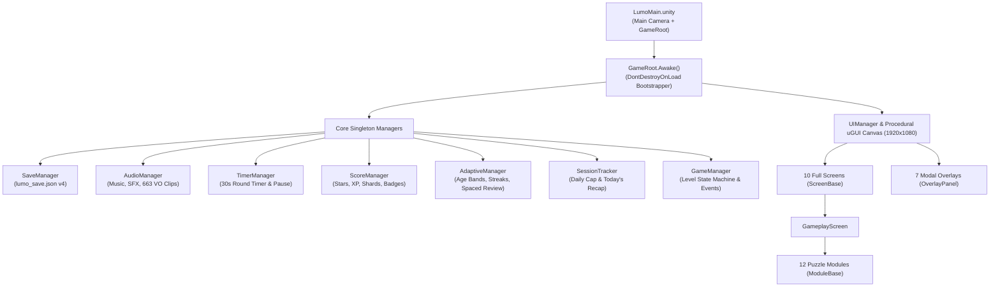

# Technical & Engineering Architecture — Lumo and the Crystal of Knowledge

---

## 1. Architectural Overview

**Lumo and the Crystal of Knowledge** uses a **100% code-driven, zero-prefab procedural uGUI architecture** running inside a single Unity scene ([`Assets/Scenes/LumoMain.unity`](file:///d:/Unity/lumooo/Assets/Scenes/LumoMain.unity)). All screens, overlays, puzzle modules, and animations are constructed deterministically in C# at startup, eliminating broken prefab references and guaranteeing resolution-independent layout on a `1920×1080` reference canvas.



---

## 2. Core Subsystem Reference (`Assets/Scripts/Core/`)

| File | Class | Responsibility |
|---|---|---|
| [`GameRoot.cs`](file:///d:/Unity/lumooo/Assets/Scripts/UI/GameRoot.cs) | `GameRoot` | Entry-point `MonoBehaviour` in `LumoMain.unity`. Instantiates all singleton managers in deterministic order, loads `levels.json`, builds the `UIManager` canvas, and attaches `AutoTestDriver` / `QaTestDriver` in the Editor. |
| [`GameManager.cs`](file:///d:/Unity/lumooo/Assets/Scripts/Core/GameManager.cs) | `GameManager` | Central state machine governing level lifecycle (`StartLevel`, `LoadCurrentRound`, `ReportAnswer`, `Advance`, `CompleteLevel`), mistake counting, hint/solution triggers, struggle-choice offers, and spaced review injection. |
| [`QuestionManager.cs`](file:///d:/Unity/lumooo/Assets/Scripts/Core/QuestionManager.cs) | `QuestionManager` | Parses and strictly validates [`Assets/Resources/Data/levels.json`](file:///d:/Unity/lumooo/Assets/Resources/Data/levels.json) at boot (verifying all 13 levels, 13 skills, 30 ILOs, 87 core challenges, 110 variants, and media integrity). |
| [`AdaptiveManager.cs`](file:///d:/Unity/lumooo/Assets/Scripts/Core/AdaptiveManager.cs) | `AdaptiveManager` | Selects age-band variants (`5–7`, `8–10`, `11–12`), updates skill streaks (`firstTryStreak`, `failStreak`), awards Mastery Medals, and picks spaced-review vocabulary words. |
| [`ScoreManager.cs`](file:///d:/Unity/lumooo/Assets/Scripts/Core/ScoreManager.cs) | `ScoreManager` | Computes per-round stars via `GameRules`, records best stars per round slot, awards first-completion XP and no-hint bonuses, counts Crystal Shards (`0..12`), and evaluates badge unlocks. |
| [`SaveManager.cs`](file:///d:/Unity/lumooo/Assets/Scripts/Core/SaveManager.cs) | `SaveManager` | Atomic JSON persistence (`Application.persistentDataPath/lumo_save.json` with `.bak` fallback) and schema migration/normalization (`v1/v2/v3 → v4`). |
| [`AudioManager.cs`](file:///d:/Unity/lumooo/Assets/Scripts/Core/AudioManager.cs) | `AudioManager` | Manages three dedicated `AudioSource` channels (`Music`, `SFX`, `Voice`), pre-caches SFX clips, and enforces child/parent mute settings. |
| [`TimerManager.cs`](file:///d:/Unity/lumooo/Assets/Scripts/Core/TimerManager.cs) | `TimerManager` | Frame-accurate countdown timer (`30s`) for Timed Mode; automatically pauses when `PausePanel` or `HintPanel` is open and stays disabled in Untimed/Calm/Practice modes. |
| [`SessionTracker.cs`](file:///d:/Unity/lumooo/Assets/Scripts/Core/SessionTracker.cs) | `SessionTracker` | Tracks active session duration, enforces the parent-configured daily play-time cap (`15 / 30 / 45 min`), records per-island exploration time (`islandSeconds`), and generates the kid-facing *Today's Adventure* recap. |
| [`PlayLog.cs`](file:///d:/Unity/lumooo/Assets/Scripts/Core/PlayLog.cs) & [`SessionReport.cs`](file:///d:/Unity/lumooo/Assets/Scripts/Core/SessionReport.cs) | `PlayLog`, `SessionReport` | In-memory 500-event ring buffer of round telemetry (`attempts`, `hints`, `seconds_to_correct`, `first_try`) and CSV generator for parent/educator export. |
| [`GameAssets.cs`](file:///d:/Unity/lumooo/Assets/Scripts/Core/GameAssets.cs) | `GameAssets` | Strongly-typed `Resources.Load` wrapper with in-memory sprite/audio caching (`Bg`, `Char`, `Obj`, `Ui`, `Voice`, `Sfx`, `Music`). |

---

## 3. UI & Module Architecture (`Assets/Scripts/UI/` & `Assets/Scripts/Modules/`)

### 3.1 `UIKit` & Canvas Setup
- **Canvas Resolution:** `1920×1080` (`CanvasScaler.ScaleMode.ScaleWithScreenSize`, `matchWidthOrHeight = 0.5f`).
- **Helper Primitives ([`UIKit.cs`](file:///d:/Unity/lumooo/Assets/Scripts/UI/UIKit.cs)):**
  - `UIKit.Place(rt, anchor, offset, size)` — Anchor-relative positioning (`(0,0)` bottom-left to `(1,1)` top-right).
  - `UIKit.Card` / `UIKit.Panel` — 9-slice parchment/navy containers with automatic fallback to `Image.Type.Simple` when a sprite has zero 9-slice borders.
  - `UIKit.TextButton` — Pill buttons with automatic shadow, warm-ink outline, dark/light contrast text selection, and press-bounce coroutine (`ButtonJuice`).
  - `UIKit.Label` / `UIKit.StyleTitle` — TextMeshPro labels using `font_main` (`Baloo 2 Bold`) with `enableAutoSizing` on multi-line containers.

### 3.2 Full Screens (`ScreenBase`)
Registered in [`UIManager.Awake()`](file:///d:/Unity/lumooo/Assets/Scripts/UI/UIManager.cs):
1. `Splash` ([`SplashScreen.cs`](file:///d:/Unity/lumooo/Assets/Scripts/UI/SplashScreen.cs))
2. `MainMenu` ([`MainMenuScreen.cs`](file:///d:/Unity/lumooo/Assets/Scripts/UI/MainMenuScreen.cs))
3. `CharacterSelect` ([`CharacterSelectScreen.cs`](file:///d:/Unity/lumooo/Assets/Scripts/UI/CharacterSelectScreen.cs))
4. `Tutorial` ([`TutorialScreen.cs`](file:///d:/Unity/lumooo/Assets/Scripts/UI/TutorialScreen.cs))
5. `WorldMap` ([`WorldMapScreen.cs`](file:///d:/Unity/lumooo/Assets/Scripts/UI/WorldMapScreen.cs))
6. `LevelIntro` ([`LevelIntroScreen.cs`](file:///d:/Unity/lumooo/Assets/Scripts/UI/LevelIntroScreen.cs))
7. `Gameplay` ([`GameplayScreen.cs`](file:///d:/Unity/lumooo/Assets/Scripts/UI/GameplayScreen.cs))
8. `LevelResult` ([`ResultScreens.cs`](file:///d:/Unity/lumooo/Assets/Scripts/UI/ResultScreens.cs))
9. `ProgressReport` ([`ResultScreens.cs`](file:///d:/Unity/lumooo/Assets/Scripts/UI/ResultScreens.cs))
10. `FinalResult` ([`ResultScreens.cs`](file:///d:/Unity/lumooo/Assets/Scripts/UI/ResultScreens.cs))
11. `SessionRecap` ([`SessionRecapScreen.cs`](file:///d:/Unity/lumooo/Assets/Scripts/UI/SessionRecapScreen.cs))

### 3.3 Modal Overlays (`OverlayPanel`)
1. `Settings` ([`Panels.cs`](file:///d:/Unity/lumooo/Assets/Scripts/UI/Panels.cs))
2. `HowToPlay` ([`Panels.cs`](file:///d:/Unity/lumooo/Assets/Scripts/UI/Panels.cs))
3. `Collection` ([`Panels.cs`](file:///d:/Unity/lumooo/Assets/Scripts/UI/Panels.cs))
4. `Hint` ([`Panels.cs`](file:///d:/Unity/lumooo/Assets/Scripts/UI/Panels.cs))
5. `Pause` ([`Panels.cs`](file:///d:/Unity/lumooo/Assets/Scripts/UI/Panels.cs))
6. `Parents` ([`ParentsArea.cs`](file:///d:/Unity/lumooo/Assets/Scripts/UI/ParentsArea.cs))
7. `PinGate` ([`ParentsArea.cs`](file:///d:/Unity/lumooo/Assets/Scripts/UI/ParentsArea.cs))
8. `TimeUp` ([`ParentsArea.cs`](file:///d:/Unity/lumooo/Assets/Scripts/UI/ParentsArea.cs))
9. `ParentTips` ([`ParentsArea.cs`](file:///d:/Unity/lumooo/Assets/Scripts/UI/ParentsArea.cs))
10. `MyWords` ([`ParentsArea.cs`](file:///d:/Unity/lumooo/Assets/Scripts/UI/ParentsArea.cs))

---

## 4. Save Data Schema (`SaveData.cs`, Version 4)

Stored at `Application.persistentDataPath/lumo_save.json`:

```json
{
  "version": 4,
  "avatar": 1,
  "tutorialDone": true,
  "highestUnlocked": 13,
  "lastLevel": 1,
  "totalStars": 132,
  "totalXp": 640,
  "musicOn": true,
  "soundOn": true,
  "voiceOn": true,
  "calmMode": false,
  "timedMode": false,
  "freeExplore": true,
  "ageBand": 1,
  "dailyLimitMinutes": 0,
  "parentPin": "",
  "islandSeconds": [0, 0, 0, 0, 0, 0, 0, 0, 0, 0, 0, 0, 0],
  "badges": ["Math Master"],
  "medals": ["addition"],
  "wordsLearned": ["cat", "dog", "red"],
  "wordCleanLevels": ["cat|2", "cat|5"],
  "focusWords": [],
  "levelFeelIds": [1],
  "levelFeelVals": [0],
  "levelRecords": [
    { "levelId": 1, "completed": true, "perfectNoHint": true, "stars": [3, 3, 3, 3, 3, 3] }
  ],
  "skills": [
    { "attempts": 6, "firstTryCorrect": 6, "hintsUsed": 0, "firstTryStreak": 0, "failStreak": 0, "mastery": 2, "remediation": false, "pendingHarder": true }
  ]
}
```

---

## 5. Automated Testing & Verification Suites

### 5.1 Editor Menu Test Suite ([`Assets/Tests/LumoTests.cs`](file:///d:/Unity/lumooo/Assets/Tests/LumoTests.cs))
Accessible via **`Lumo → Tests → Run All Day1`**:
- **`ValidateData`:** Validates `levels.json` schema, 13 levels, 72 core + 15 finale rounds, 110 variants, and skill coverage.
- **`StarRules`:** Boundary-tests `GameRules.StarsForTime` (`8s, 10s, 15s, 20s, 24s, 30s, 31s`), LXD C1 first-try accuracy gate, and 261-star capacity.
- **`AuditAssets`:** Verifies that every sprite, background, character, object, SFX, music track, font, and all 663 voice-over clips referenced by `levels.json` load via `Resources.Load`.
- **`Phase1Checks`:** Verifies calm star rules, `IslandCatalog` integrity, `SaveManager.Normalize` clamping, and `v2 → v4` save upgrades.
- **`Phase2Checks`:** Verifies all 13 skills, 12 module types, 87 core + 110 variants, zero Arabic characters, age-band variant lookup, and `v3 → v4` migration.
- **`Phase3Checks`:** Audits retry lines for discouraged words (`WRONG`, `FAIL`, `LOSE`, `GAME OVER`), checks `PixelArtModule.ColorNameForHex`, validates `ParentsPanel` helpers, and checks texture dimensions + `Docs/STYLE_GUIDE.md`.
- **`LxdChecks`:** Audits all 30 ILOs, challenge ILO indices, non-empty strategy retries, `feedback.explain` lengths (`≤ 160 chars`), medal deduplication, level reflection persistence, focus-word review priority, 2-level word mastery, parent tips, session recap generation, `PlayLog` 500-cap ring buffer + CSV export, and the struggle-choice truth table.

### 5.2 Live Play-Mode Drivers
- **[`AutoTestDriver.cs`](file:///d:/Unity/lumooo/Assets/Scripts/Core/AutoTestDriver.cs):** Driven by creating `_tools/autotest.txt` containing `all` (plays all 87 challenges across all 13 levels automatically and restores the user's save file afterward) or a level number `1..13`.
- **[`QaTestDriver.cs`](file:///d:/Unity/lumooo/Assets/Scripts/Core/QaTestDriver.cs):** Driven by writing `qa` to `_tools/autotest.txt`; tests Free Sail unlocking, live age-band routing, untimed/calm mode, practice mode, pause/resume timer freezing, real uGUI button click navigation, and save persistence.
